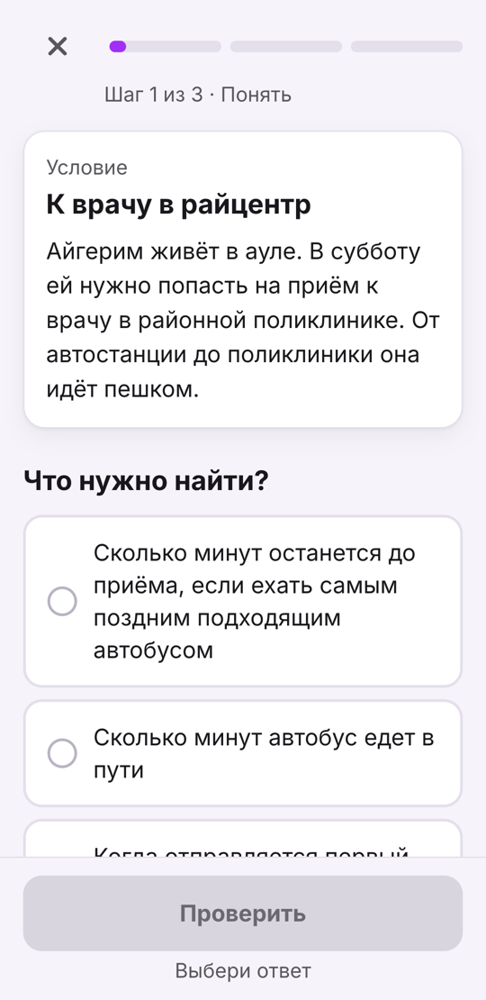
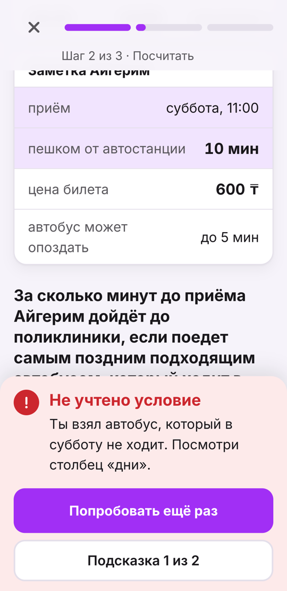
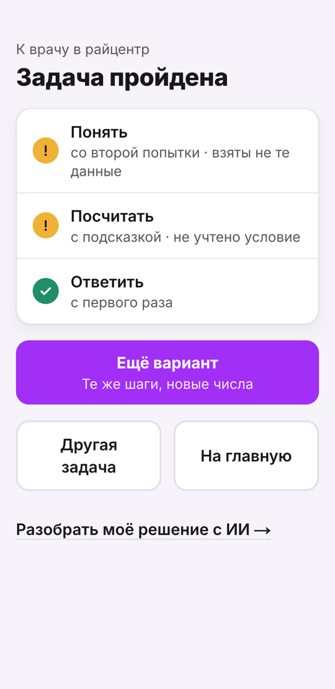
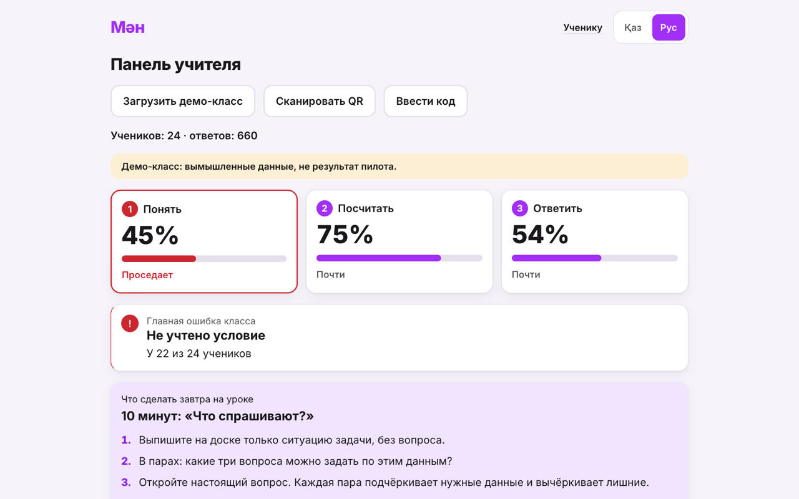
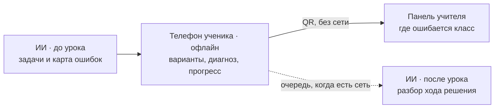

<div align="center">

# Мән

### Понять, а потом посчитать

Офлайн-тренажёр математической грамотности для 7–9 классов.<br>
Показывает, **на каком шаге задачи** ошибся ученик, — и работает без интернета.

**[Открыть демо](https://man-orleu.vercel.app)** · **[Панель учителя](https://man-orleu.vercel.app/teacher)** · **[Питч-видео, 2:22](https://drive.google.com/file/d/15YFYrrjfH823hUDdkE6oNZwF764rnQxd/view)**

Órleu Hack 2026 · кейс 3 «Образование: читать и понимать» · команда CtrlX

<br>

&nbsp;&nbsp;
&nbsp;&nbsp;


</div>

## Зачем

- В PISA-2025 **56 из 100** казахстанских 15-летних не достигли базового уровня по математике; в сельских школах результат ниже на 18 баллов (PISA-2022).
- Задача из жизни — это текст: расписание, чек, тариф. Обычный тренажёр проверяет только число в конце и говорит «неверно».
- ИИ-чату нужен интернет в момент урока, и он решает за ученика. А 41% подключённых школ страны — не на оптике.

## Что умеет

| | |
|---|---|
| **Три шага** | Понять → Посчитать → Ответить. Одно действие на экран |
| **Диагноз вместо «неверно»** | Число вводится без вариантов; телефон узнаёт, каким ошибочным путём оно получено: «взял автобус, который в субботу не ходит» |
| **«Ещё вариант»** | Та же задача с новыми числами создаётся на телефоне. Списать нельзя |
| **Без сети** | После первого открытия работает в авиарежиме: задачи, варианты, диагноз, прогресс |
| **Учитель** | Собирает результаты по QR без сервера и видит, на каком шаге ошибается класс и что сделать завтра |
| **Без телефонов** | Печатные варианты: у каждого ученика свои числа, учителю — ключ |
| **Замер «до и после»** | Те же задачи с другими числами, без подсказок |

10 задач из жизни на казахском и русском: автобус до райцентра, акции в магазине, мобильный интернет, рассрочка, доза сиропа, бауырсаки на гостей, сено на зиму, тариф на электричество, рассада, масштаб карты.

<div align="center">

<br><sub>Панель учителя. Данные демонстрационные</sub>
</div>

## Проверьте за 2 минуты

1. Откройте [man-orleu.vercel.app](https://man-orleu.vercel.app) на телефоне и пройдите одну задачу.
2. Включите **авиарежим** и обновите страницу — приложение откроется.
3. Введите на шаге «Посчитать» неверное число — увидите название ошибки. Нажмите «Ещё вариант» — числа изменятся.
4. Откройте [/teacher](https://man-orleu.vercel.app/teacher) и нажмите «Загрузить демо-класс».

## Как устроено



- **ИИ работает до урока и после.** Сам урок считает телефон: 0 КБ трафика.
- **Ответы проверяет код, а не модель.** Верный ответ и каждый ошибочный путь вычисляются формулами; автотест прогоняет 200 вариантов каждой задачи.
- **ИИ не выдаёт ответ.** Разбор называет шаг, где сломалось рассуждение, и задаёт один вопрос; сервер дополнительно вырезает ответ, если модель его написала.
- **Нет аккаунтов и базы данных.** Данные детей остаются на телефоне.

**Стек:** Next.js 16 · React 19 · TypeScript · Tailwind CSS 4 · PWA с собственным service worker · IndexedDB · Vercel.

## Запуск

```bash
git clone https://github.com/hackathon-kz/orleu-hack-2026-186-ctrlx.git
cd orleu-hack-2026-186-ctrlx
pnpm install
pnpm test                  # автотест задач: 200 вариантов на каждую
pnpm build && pnpm start   # офлайн-режим проверяйте на сборке, не в next dev
```

ИИ необязателен: без ключей урок работает целиком. Чтобы включить разбор решений, скопируйте `.env.example` в `.env.local` и впишите ключ.

<details>
<summary><b>Переменные окружения</b></summary>

| Переменная | Зачем |
|---|---|
| `ALEM_API_KEY` | ИИ через Alem API, используется первым |
| `ALEM_MODEL` | модель Alem; в продукте — `astanahub/alemllm` |
| `ALEM_FALLBACK_MODEL`, `ALEM_FALLBACK_API_KEY` | запасная модель; в продукте — `Qwen/Qwen3.6-35B-A3B` |
| `ALEM_BASE_URL` | адрес шлюза Alem; в продукте — `https://api.bbx.kz/os/v1/alem` |
| `ANTHROPIC_API_KEY` | запасной провайдер Claude |

Порядок: Alem → запасная модель Alem → Claude → честный ответ 503, запрос остаётся в очереди.

</details>

<details>
<summary><b>Структура проекта</b></summary>

```
app/page.tsx              ученик: онбординг, урок, итог, прогресс, QR
app/teacher/page.tsx      панель учителя
app/api/explain/          разбор хода решения
app/api/generate/         задача из местного контекста с перепроверкой арифметики
public/sw.js              service worker
lib/templates/            10 задач kk/ru с картами ошибочных путей
lib/engine.ts             вариант задачи по числу-зерну, проверка шагов
lib/exam.ts               замер «до и после»
lib/llm.ts                провайдеры ИИ
scripts/test-templates.ts автотест
```

</details>

## Честно об ограничениях

- **Пилота с учениками не было.** Эффект на обучение — гипотеза; в приложении есть замер «до и после», чтобы её проверить.
- **Задачи написаны ИИ** и ждут вычитки учителем; казахский текст носителем не вычитан.
- **ИИ отвечает только при наличии сети.** Без неё разбор решения ждёт в очереди и уходит, когда связь появится; урок, диагноз, прогресс и панель учителя от ИИ не зависят.
- **Сканер QR камерой** не проверен на реальном телефоне; ввод кода вручную проверен. Офлайн-режим проверен эмуляцией в браузере.

## Использованные инструменты

По п. 6.3 положения:

- **Claude (Anthropic)** — код, задачи и карты ошибок, тексты на казахском и русском, исследование, презентация, монтаж видео.
- **AlemLLM** (`astanahub/alemllm`, Astana Hub) через Alem API, запасная модель Qwen 3.6 — разбор хода решения ученика и задача из местного контекста внутри продукта. Ответ проверяет сервер: ИИ не может выдать верный ответ, а задачу с несходящейся арифметикой учитель не увидит.
- **ElevenLabs** — озвучка питч-видео. Музыка в видео: Sascha Ende, [ende.app](https://ende.app/en) (CC BY 4.0).
- Next.js, React, Tailwind CSS, Vercel, idb-keyval, qrcode, jsQR, шрифт Inter.

## Команда

**CtrlX**, команда №186 на hackathon.kz.
